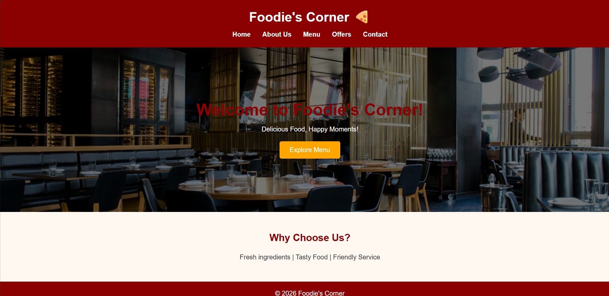
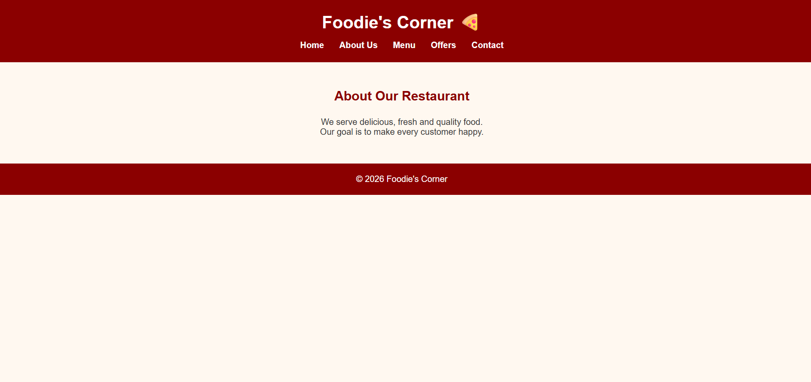
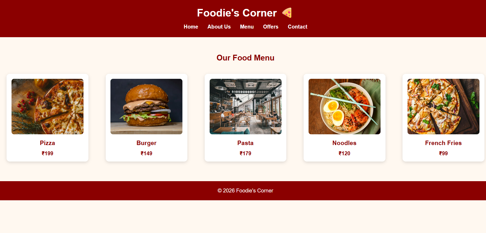
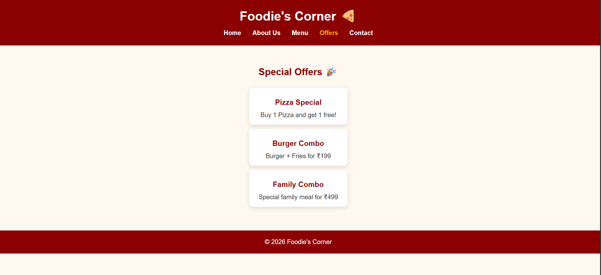

# Ex02 – Commercial Website

## Date:
02-11-2026

## AIM

To design and develop a commercial restaurant website using HTML and CSS Flexbox with a professional layout, navigation bar, homepage, about section, food menu, special offers, contact details, and footer.

## ALGORITHM

### STEP 1
Create a project folder named `RestaurantWebsite`.

### STEP 2
Create HTML files such as `index.html`, `about.html`, `menu.html`, `offers.html`, and `contact.html`.

### STEP 3
Create an external CSS file named `style.css`.

### STEP 4
Add a navigation bar with links to Home, About Us, Menu, Offers, and Contact pages.

### STEP 5
Design the homepage with the restaurant name, welcome message, background image, and Explore Menu button.

### STEP 6
Create an About Us page describing the restaurant and its services.

### STEP 7
Create a Menu page displaying different food items, images, and prices.

### STEP 8
Add an Offers page displaying special food offers and combo packages.

### STEP 9
Create a Contact page with email, phone number, location, and opening hours.

### STEP 10
Define global CSS styles for fonts, colors, margins, and padding.

### STEP 11
Use CSS Flexbox to arrange food cards and navigation links.

### STEP 12
Add hover effects, transitions, background images, border radius, and shadows to improve the website appearance.

### STEP 13
Use media queries to make the website responsive on different screen sizes.

### STEP 14
Add a footer with copyright information to all pages.

### STEP 15
Open `index.html` in a browser and test all navigation links and website pages.

### STEP 16
Upload the project files to GitHub and deploy the website using GitHub Pages.

## PROGRAM

### index.html – Home Page

```html
<!DOCTYPE html>
<html lang="en">
<head>
    <meta charset="UTF-8">
    <meta name="viewport" content="width=device-width, initial-scale=1.0">
    <title>Foodie's Corner - Restaurant</title>
    <link rel="stylesheet" href="style.css">
</head>
<body>

<header>
    <h1>Foodie's Corner 🍕</h1>
    <nav>
        <a href="index.html">Home</a>
        <a href="about.html">About Us</a>
        <a href="menu.html">Menu</a>
        <a href="offers.html">Offers</a>
        <a href="contact.html">Contact</a>
    </nav>
</header>

<section class="hero">
    <h2>Welcome to Foodie's Corner!</h2>
    <p>Delicious Food, Happy Moments!</p>
    <a href="menu.html" class="btn">Explore Menu</a>
</section>

<section>
    <h2>Why Choose Us?</h2>
    <p>Fresh Ingredients | Tasty Food | Friendly Service</p>
</section>

<footer>
    <p>© 2026 Foodie's Corner. All Rights Reserved.</p>
</footer>

</body>
</html>
```

### about.html – About Us Page

```html
<!DOCTYPE html>
<html>
<head>
    <title>About Us</title>
    <link rel="stylesheet" href="style.css">
</head>
<body>

<header>
    <h1>Foodie's Corner 🍕</h1>
    <nav>
        <a href="index.html">Home</a>
        <a href="about.html">About Us</a>
        <a href="menu.html">Menu</a>
        <a href="offers.html">Offers</a>
        <a href="contact.html">Contact</a>
    </nav>
</header>

<section>
    <h2>About Our Restaurant</h2>
    <p>Welcome to Foodie's Corner! We serve fresh,
    delicious and quality food for everyone.</p>
    <p>Our goal is to make every customer happy.</p>
</section>

<footer>
    <p>© 2026 Foodie's Corner. All Rights Reserved.</p>
</footer>

</body>
</html>
```

### menu.html – Food Menu Page

```html
<!DOCTYPE html>
<html>
<head>
    <title>Our Menu</title>
    <link rel="stylesheet" href="style.css">
</head>
<body>

<header>
    <h1>Foodie's Corner 🍕</h1>
    <nav>
        <a href="index.html">Home</a>
        <a href="about.html">About Us</a>
        <a href="menu.html">Menu</a>
        <a href="offers.html">Offers</a>
        <a href="contact.html">Contact</a>
    </nav>
</header>

<section>
    <h2>Our Special Menu</h2>

    <div class="menu-container">

        <div class="food">
            
            <h3>Pizza</h3>
            <p>₹199</p>
        </div>

        <div class="food">
            
            <h3>Burger</h3>
            <p>₹149</p>
        </div>

        <div class="food">
            
            <h3>Pasta</h3>
            <p>₹179</p>
        </div>

        <div class="food">
            
            <h3>Noodles</h3>
            <p>₹120</p>
        </div>

        <div class="food">
            
            <h3>French Fries</h3>
            <p>₹99</p>
        </div>

    </div>
</section>

<footer>
    <p>© 2026 Foodie's Corner. All Rights Reserved.</p>
</footer>

</body>
</html>
```

### offers.html – Special Offers Page

```html
<!DOCTYPE html>
<html>
<head>
    <title>Special Offers</title>
    <link rel="stylesheet" href="style.css">
</head>
<body>

<header>
    <h1>Foodie's Corner 🍕</h1>
    <nav>
        <a href="index.html">Home</a>
        <a href="about.html">About Us</a>
        <a href="menu.html">Menu</a>
        <a href="offers.html">Offers</a>
        <a href="contact.html">Contact</a>
    </nav>
</header>

<section>
    <h2>Special Offers 🎉</h2>

    <div class="offer">
        <h3>Pizza Special</h3>
        <p>Buy 1 Pizza and Get 1 Free!</p>
    </div>

    <div class="offer">
        <h3>Burger Combo</h3>
        <p>Burger + Fries for ₹199</p>
    </div>

    <div class="offer">
        <h3>Family Combo</h3>
        <p>Special Family Meal for ₹499</p>
    </div>
</section>

<footer>
    <p>© 2026 Foodie's Corner. All Rights Reserved.</p>
</footer>

</body>
</html>
```

### contact.html – Contact Page

```html
<!DOCTYPE html>
<html>
<head>
    <title>Contact Us</title>
    <link rel="stylesheet" href="style.css">
</head>
<body>

<header>
    <h1>Foodie's Corner 🍕</h1>
    <nav>
        <a href="index.html">Home</a>
        <a href="about.html">About Us</a>
        <a href="menu.html">Menu</a>
        <a href="offers.html">Offers</a>
        <a href="contact.html">Contact</a>
    </nav>
</header>

<section>
    <h2>Contact Us</h2>

    <p>Email: foodiescorner@gmail.com</p>
    <p>Phone: +91 98765 43210</p>
    <p>Location: Chennai, Tamil Nadu</p>

    <h3>Opening Hours</h3>
    <p>Monday - Sunday: 10 AM to 10 PM</p>
</section>

<footer>
    <p>© 2026 Foodie's Corner. All Rights Reserved.</p>
</footer>

</body>
</html>
```

### style.css – CSS Styling

```css
* {
    margin: 0;
    padding: 0;
    box-sizing: border-box;
    font-family: Arial, sans-serif;
}

html {
    scroll-behavior: smooth;
}

body {
    background-color: #fff8f0;
    color: #333;
}

header {
    background-color: #8b0000;
    color: white;
    padding: 20px;
    text-align: center;
}

nav {
    display: flex;
    justify-content: center;
    gap: 25px;
    flex-wrap: wrap;
    margin-top: 15px;
}

nav a {
    color: white;
    text-decoration: none;
    font-weight: bold;
}

nav a:hover {
    color: orange;
}

.hero {
    background: linear-gradient(#0008, #0008),
    url("https://images.unsplash.com/photo-1517248135467-4c7edcad34c4?w=1200");
    background-size: cover;
    background-position: center;
    color: white;
    text-align: center;
    padding: 130px 20px;
}

.hero h2 {
    font-size: 40px;
    margin-bottom: 15px;
}

.hero p {
    font-size: 18px;
}

.btn {
    display: inline-block;
    background-color: orange;
    color: white;
    padding: 12px 25px;
    margin-top: 20px;
    text-decoration: none;
    border-radius: 5px;
}

.btn:hover {
    background-color: #e68900;
}

section {
    padding: 50px 20px;
    text-align: center;
}

section h2 {
    color: #8b0000;
    margin-bottom: 25px;
}

.menu-container {
    display: flex;
    justify-content: center;
    flex-wrap: wrap;
    gap: 25px;
}

.food, .offer {
    background-color: white;
    width: 250px;
    padding: 15px;
    border-radius: 10px;
    box-shadow: 0 3px 10px #0002;
    transition: transform 0.3s;
}

.food:hover, .offer:hover {
    transform: translateY(-8px);
}

.food img {
    width: 100%;
    height: 170px;
    object-fit: cover;
    border-radius: 8px;
}

.food h3, .offer h3 {
    margin: 12px;
    color: #8b0000;
}

.food p {
    color: #8b0000;
    font-weight: bold;
}

footer {
    background-color: #8b0000;
    color: white;
    text-align: center;
    padding: 20px;
}

@media (max-width: 600px) {
    nav {
        gap: 15px;
    }

    .hero h2 {
        font-size: 30px;
    }

    .menu-container {
        flex-direction: column;
        align-items: center;
    }
}
```

## OUTPUT





## RESULT

Thus, a commercial restaurant website named **Foodie's Corner** was successfully designed and developed using HTML and CSS Flexbox with multiple pages, navigation links, food menu, special offers, contact details, responsive layout, and footer.